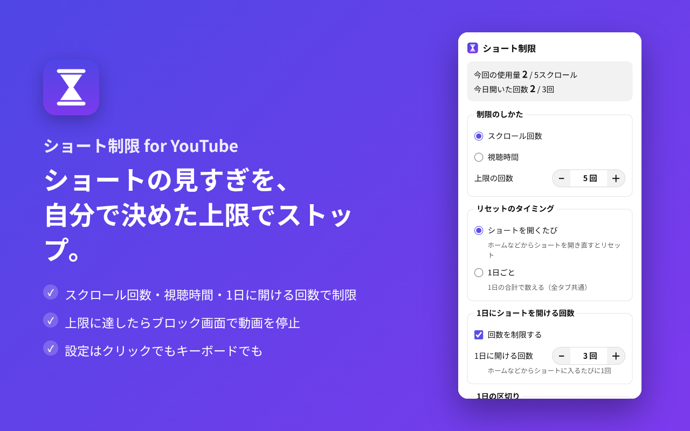
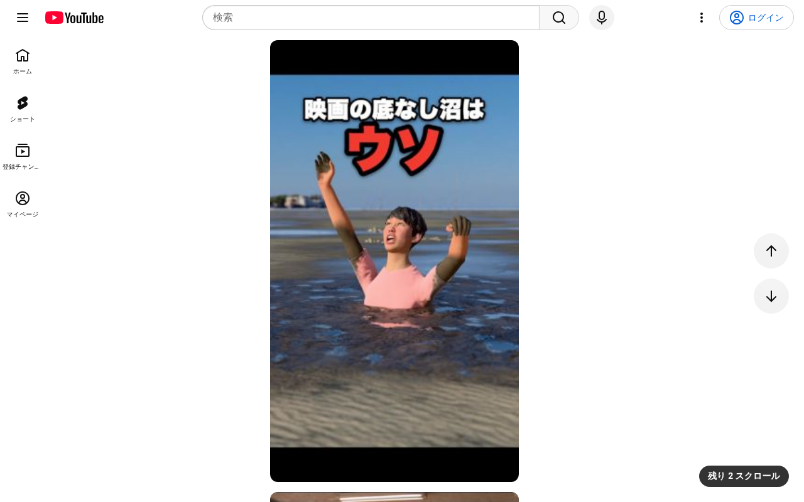
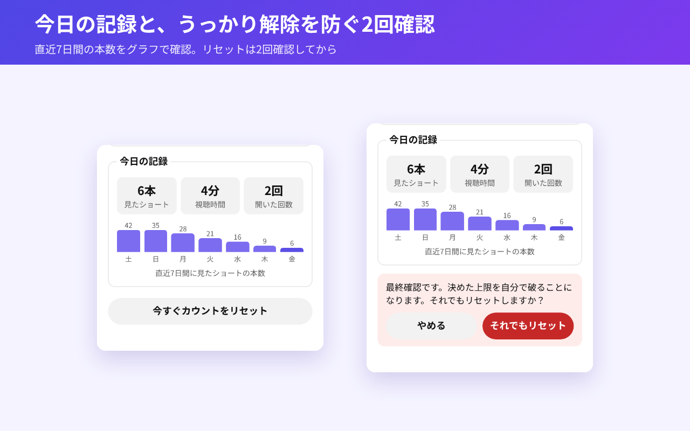

# ショート制限 for YouTube（Shorts Limiter for YouTube）

YouTubeショートの見すぎを防ぐChrome拡張機能です。スクロール回数・視聴時間・1日に開ける回数で制限し、上限に達するとブロック画面を表示します。

**[Chromeウェブストアからインストール](https://chromewebstore.google.com/detail/hbflalifpcbneopppdheicgnhilhhbpi)**

| 上限に達したときのブロック画面 | 残りの表示 | 今日の記録とリセットの2回確認 |
| --- | --- | --- |
|  |  |  |

※ 画像の動画部分はイメージ用のイラストです。

## できること

- **スクロール回数で制限**（既定3回）、または **視聴時間で制限**（既定5分。ショートを表示していてタブが前面にある時間だけ数えます）
- **リセットのタイミング**を選べます
  - ショートを開くたび（既定）
  - 1日ごと（全タブの合計）
- **1日にショートを開ける回数**（既定オフ、オンにすると既定3回）。ホームなどからショートに入るたびに1回と数えます
- **1日の区切り**は毎日4時（変更できます）
- ショート画面の右下に残り回数・残り時間を表示（残りわずかになるとオレンジ色に変わります）
- 上にスクロールして見たことのあるショートに戻ったときは数えません（新しいショートに進んだときだけ数えます）
- 上限に達すると動画を止めてブロック画面（「ホームへ戻る」ボタン付き）で覆い、ホイールや矢印キーでのスクロールも止めます
- **今日の記録**: 見たショートの本数・視聴時間・開いた回数と、直近7日間の本数のグラフ
- 設定はツールバーの拡張機能アイコンから。数値は −／＋ ボタンでも、キーボードでの直接入力（Enterで確定、↑↓キーで増減）でも変えられ、変更はすぐ保存されます
- 「今すぐカウントをリセット」は、うっかり制限を外さないよう **2回確認してから** 実行します
- 日本語と英語に対応（ブラウザの言語に合わせて切り替わります）
- ダークモードに対応

## インストール

### Chromeウェブストアから（おすすめ）

1. [Chromeウェブストアのページ](https://chromewebstore.google.com/detail/hbflalifpcbneopppdheicgnhilhhbpi)を開く
2. 「Chromeに追加」を押し、確認画面で「拡張機能を追加」を押す
3. 開いていたYouTubeのタブを再読み込みする

ストア版は自動で更新されます。

### ZIPから（デベロッパーモード）

ストアを使わずに入れたい場合や、ストアに反映される前の最新版を試したい場合の方法です。

1. [Releases](https://github.com/check5004/youtube-shorts-limiter/releases/latest) を開き、**Assets** にある `shorts-limiter-vX.Y.Z.zip` をダウンロードして展開する（「Source code」のZIPではありません）
2. Chromeで `chrome://extensions` を開く
3. 右上の「デベロッパーモード」をオンにする
4. 「パッケージ化されていない拡張機能を読み込む」を押し、展開した `shorts-limiter` フォルダ（`manifest.json` が入っているフォルダ）を選ぶ
5. 開いていたYouTubeのタブを再読み込みする

※ 読み込んだフォルダは削除・移動しないでください（拡張機能が使えなくなります）。

更新するときは、新しいZIPの中身で `shorts-limiter` フォルダを置き換えてから、`chrome://extensions` の拡張機能カードにある再読み込みボタンを押してください。

### ソースから読み込む場合

このリポジトリを `git clone` したフォルダ（直下に `manifest.json` があります）をそのまま読み込むこともできます。更新は `git pull` のあと再読み込みボタンを押します。

## ファイル構成

| ファイル | 役割 |
| --- | --- |
| `manifest.json` | 拡張機能の定義（Manifest V3） |
| `content.js` | YouTube上でカウント・残り表示・ブロック・記録を行うスクリプト |
| `overlay.css` | ブロック画面と残り表示のスタイル |
| `popup.html` / `popup.js` | 設定画面 |
| `_locales/` | 表示する文言（日本語・英語） |
| `icons/` | アイコン |
| `scripts/build-zip.sh` | Chromeウェブストア提出用のZIPを作るスクリプト |

## プライバシー

使う権限は `storage`（設定とカウントの保存）だけで、動作するのは `youtube.com` 上のみです。データはブラウザ内に保存され、外部には送信しません。詳しくは [プライバシーポリシー](PRIVACY.md) をご覧ください。

## 商標について

YouTube は Google LLC の商標です。本拡張機能は Google LLC および YouTube とは関係がなく、承認・提携を受けたものではありません。

## ライセンス

[MIT License](LICENSE)
