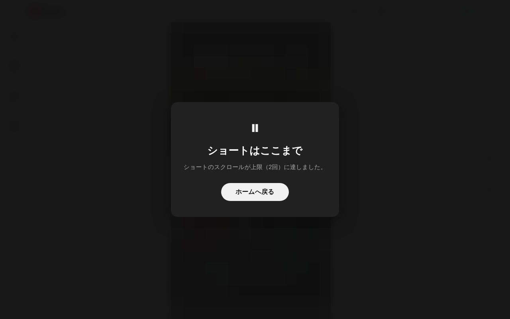
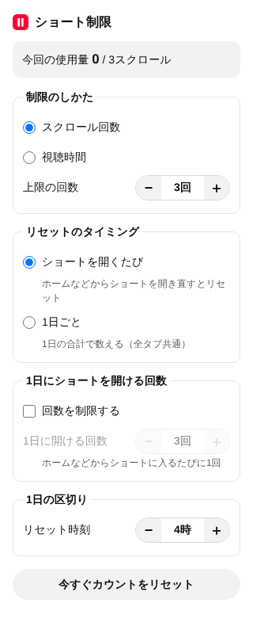

# ショート制限（YouTube Shorts Limiter）

YouTubeショートの見すぎを防ぐChrome拡張機能です。スクロール回数・視聴時間・1日の上限で制限し、超えるとブロック画面を表示します。

| 残り回数の表示 | 上限に達したときのブロック画面 | 設定画面 |
| --- | --- | --- |
|  |  |  |

## できること

- **スクロール回数で制限**（既定3回）、または **視聴時間で制限**（既定5分。ショートを表示していてタブが前面にある時間だけ数えます）
- **リセットのタイミング**を選べます
  - ショートを開くたび（既定）
  - 1日ごと（全タブの合計）
- **1日にショートを開ける回数**（既定オフ、オンにすると既定3回）。ホームなどからショートに入るたびに1回と数えます
- **1日の区切り**は毎日4時（変更できます）
- ショート画面の右下に残り回数・残り時間を表示
- 上限に達すると動画を止めてブロック画面（「ホームへ戻る」ボタン付き）で覆い、ホイールや矢印キーでのスクロールも止めます
- 設定はツールバーの拡張機能アイコンから。数値は −／＋ ボタンで変更し、変更はすぐ保存されます（キーボード入力・保存ボタンは不要）
- 「今すぐカウントをリセット」ボタン

## インストール

Chromeウェブストアには公開していないため、配布しているZIPをデベロッパーモードで読み込みます。

1. [Releases](https://github.com/check5004/youtube-shorts-limiter/releases/latest) を開き、**Assets** にある `shorts-limiter-vX.Y.Z.zip` をダウンロードして展開する（「Source code」のZIPではありません）
2. Chromeで `chrome://extensions` を開く
3. 右上の「デベロッパーモード」をオンにする
4. 「パッケージ化されていない拡張機能を読み込む」を押し、展開した `shorts-limiter` フォルダ（`manifest.json` が入っているフォルダ）を選ぶ
5. 開いていたYouTubeのタブを再読み込みする

※ 読み込んだフォルダは削除・移動しないでください（拡張機能が使えなくなります）。

### 更新するとき

[Releases](https://github.com/check5004/youtube-shorts-limiter/releases/latest) から新しいZIPをダウンロードし、読み込んでいる `shorts-limiter` フォルダの中身を置き換えてから、`chrome://extensions` の拡張機能カードにある再読み込みボタンを押してください。

### ソースから読み込む場合

このリポジトリを `git clone` したフォルダ（直下に `manifest.json` があります）をそのまま読み込むこともできます。更新は `git pull` のあと再読み込みボタンを押します。

## ファイル構成

| ファイル | 役割 |
| --- | --- |
| `manifest.json` | 拡張機能の定義（Manifest V3） |
| `content.js` | YouTube上でカウント・残り表示・ブロックを行うスクリプト |
| `overlay.css` | ブロック画面と残り表示のスタイル |
| `popup.html` / `popup.js` | 設定画面 |
| `icons/` | アイコン |

## プライバシー

使う権限は `storage`（設定とカウントの保存）だけで、動作するのは `youtube.com` 上のみです。データはブラウザ内に保存され、外部には送信しません。

## ライセンス

[MIT License](LICENSE)
